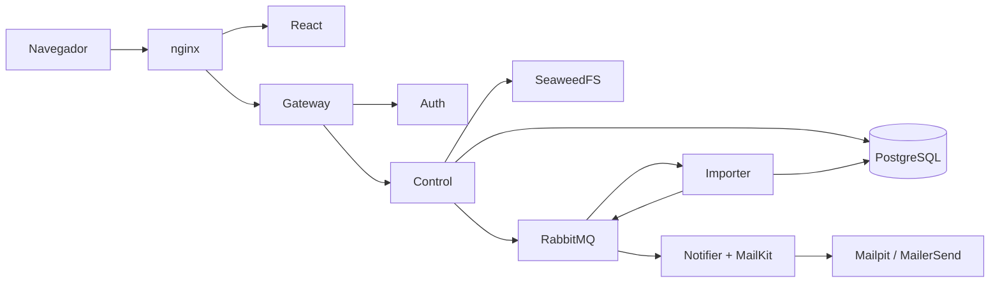

# Carga masiva de productos

Solución al reto técnico Backend Senior: subir un Excel de productos, procesarlo en segundo plano con microservicios .NET 10, consultar el resultado de cada fila y recibir un correo cuando termina.

## Demo en vivo

Además de poder levantarla en local, la solución está funcionando en mi servidor durante unos días (del 2 al 9 de noviembre de 2026):

**https://carga.srv1352300.hstgr.cloud**

Las credenciales de acceso van en el correo de la entrega. En la demo los correos se envían de verdad: podéis escribir vuestra dirección en el formulario de carga para recibir la notificación (revisad la carpeta de spam).

## Levantarla en local

Solo hace falta **Git, Docker con Compose y Python 3**. No hay que instalar .NET, Node ni bases de datos.

```sh
git clone https://github.com/jordyalania/carga-masiva-productos.git
cd carga-masiva-productos
python3 backend/tests/setup_env.py
docker compose up -d --build --wait --wait-timeout 300
```

El tercer comando crea `.env` con contraseñas aleatorias. El usuario y la contraseña para entrar son `DEMO_EMAIL` y `DEMO_PASSWORD` de ese archivo.

| Qué | Dónde |
| --- | --- |
| Aplicación | http://localhost:5180 |
| Correos recibidos (Mailpit) | http://localhost:8025 |
| Panel de RabbitMQ | http://localhost:15672 |
| API (para Postman) | http://localhost:8080 |

En local los correos no salen a internet: llegan a Mailpit, una bandeja de pruebas.

**Primera prueba:** sube el Excel del enunciado (`backend/tests/fixtures/products.xlsx`), o genera uno pequeño con `python3 scripts/create_sample.py` (se guarda en `artifacts/productos-demo.xlsx`).

## Cómo funciona



1. **Login**: Auth comprueba la contraseña (guardada con hash) y devuelve un JWT. El Gateway valida el token y limita las peticiones.
2. **Subida**: Control valida el archivo, lo guarda en SeaweedFS y crea la carga como *Pendiente*. Responde al momento: el procesamiento sigue en segundo plano.
3. **Procesamiento**: Importer recibe el aviso por la cola `carga_masiva`, lee el Excel, reserva sus periodos e inserta las filas en bloque en PostgreSQL. Cada fila queda como *Insertado*, *Existente* o *Inválido*.
4. **Notificación**: Notifier recibe el resultado por la cola `notificaciones` y envía el correo con MailKit. La carga pasa a *Notificado*.

| Servicio | Responsabilidad |
| --- | --- |
| Gateway | Entrada de la API, JWT y límite de peticiones |
| Auth | Usuarios, login y emisión de JWT |
| Control | Recepción de archivos, estados, reserva de periodos e historial |
| Importer | Lectura y validación del Excel, inserción masiva y resultado por fila |
| Notifier | Envío del correo con MailKit |
| PostgreSQL / RabbitMQ / SeaweedFS | Datos, colas y archivos originales |

Más detalle en [docs/ARQUITECTURA.md](docs/ARQUITECTURA.md).

## Reglas de negocio

- **Formato:** una hoja con las columnas `Periodo`, `CodigoProducto`, `NombreProducto` y `Precio`, en ese orden. Máximo 10 MB y 50.000 filas. Se rechazan archivos con fórmulas, macros o vínculos externos.
- **Periodos:** si un periodo del archivo ya tiene otra carga, en curso o terminada, se rechaza el archivo completo. La reserva es atómica, así que dos cargas simultáneas del mismo periodo no pueden pasar a la vez.
- **Duplicados:** si un código ya existe en la base de datos o se repite dentro del archivo, la fila se marca como *Existente* y no se sobrescribe.
- **Errores de fila:** las filas inválidas (código vacío, periodo o precio incorrecto) quedan registradas con su motivo, y el resto del archivo se carga igual.
- **Estados:** Pendiente → En proceso → Cargado → Finalizado → Notificado. *Rechazado* y *Fallido* indican incidencias.

## Fiabilidad

- **Si RabbitMQ se cae**, no se pierde ninguna carga: el aviso se guarda en la base de datos (patrón *outbox*) en la misma transacción que la carga y se publica cuando el broker vuelve.
- **Si un servicio se reinicia a mitad**, la carga se retoma desde su último punto guardado, sin duplicar productos.
- **Si falla el correo**, los productos ya están guardados y el envío se reintenta.
- Hay tres reintentos con espera y colas `.failed` para lo que no se puede procesar.
- Logs estructurados en JSON.

## Pruebas

```sh
python3 scripts/verify_local.py
```

Levanta una copia aparte de toda la solución, con sus propios datos y puertos, y ejecuta 32 comprobaciones: seguridad, reglas del Excel, concurrencia, caídas de RabbitMQ y SMTP, reinicios, persistencia y una carga de 10.000 filas. Al terminar, borra esa copia; no toca tus datos ni envía correos reales.

Tests del frontend:

```sh
npm ci --ignore-scripts && npm test
```

GitHub Actions ejecuta todas las pruebas en cada push.

## Entregables

| Qué | Dónde |
| --- | --- |
| Scripts de base de datos | [backend/database/migrate.sql](backend/database/migrate.sql) (también se aplican solos al arrancar) |
| Colección Postman | [backend/postman/cargas.postman_collection.json](backend/postman/cargas.postman_collection.json) |
| Despliegue en servidor | [docs/DESPLIEGUE.md](docs/DESPLIEGUE.md) |
| Arquitectura y decisiones | [docs/ARQUITECTURA.md](docs/ARQUITECTURA.md) |

## Correo real con MailerSend

Para enviar correos reales en lugar de Mailpit, rellena en `.env` las variables `MAILERSEND_SMTP_USER`, `MAILERSEND_SMTP_PASSWORD`, `MAILERSEND_FROM` y `NOTIFICATION_TEST_RECIPIENT`, y arranca con:

```sh
docker compose -f compose.yaml -f compose.mailersend.yaml up -d
```

## Stack

.NET 10 (ASP.NET Core minimal APIs y workers), Dapper y Npgsql COPY, PostgreSQL 17, RabbitMQ 4, SeaweedFS, MailKit, ClosedXML, React 19 + TypeScript (TanStack Start), nginx, Docker Compose y Traefik/Caddy para HTTPS.

El enunciado indica .NET 10 en el texto y .NET 8/9 en el diagrama; se eligió .NET 10.
