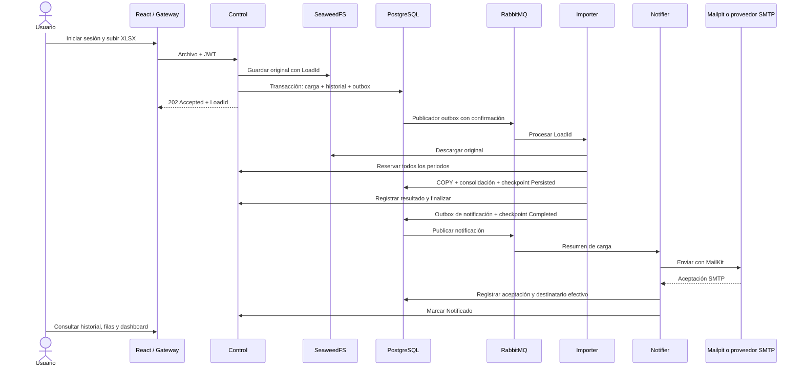

# Arquitectura y decisiones de la solución

La solución permite cargar un Excel sin mantener abierta la petición durante su procesamiento. Cada carga tiene identidad, propietario, archivo original, historial y resultados por fila. El frontend consulta esos resultados para construir el dashboard.

## Organización del repositorio

| Ruta | Contenido y criterio |
| --- | --- |
| `src/routes/`, `src/components/` | Pantallas y componentes React; las rutas componen la interfaz. |
| `src/lib/api.ts` | Acceso HTTP y sesión del frontend. |
| `src/lib/resumen.ts` | Cálculos del dashboard sobre los resultados de la carga. |
| `backend/src/Gateway/` | Entrada de API, validación JWT, límites y encaminamiento. |
| `backend/src/Auth/` | Usuarios, contraseñas hasheadas y emisión de JWT. |
| `backend/src/Control/` | Propiedad, recepción de archivos, reservas, estados e historial. |
| `backend/src/Importer/` | Validación XLSX, procesamiento, consolidación y auditoría por fila. |
| `backend/src/Notifier/` | Arranque y migraciones en `Program.cs`; consumo y correo en `NotificationWorker.cs`. |
| `backend/src/Shared/` | Contratos, autenticación interna, persistencia, outbox y consumidores RabbitMQ. |
| `backend/database/` | SQL exportado de las mismas migraciones que aplica la aplicación. |
| `backend/tests/`, `scripts/` | Verificación aislada, preparación y diagnóstico. |
| `deploy/`, `compose*.yaml` | Proxy web y variantes de despliegue. |

La separación es por servicios y responsabilidades. Los servicios usan Minimal APIs y acceso SQL con Dapper; no se afirma una implementación estricta de Clean Architecture. `Shared` agrupa infraestructura común y contratos, por lo que sus cambios requieren recompilar los servicios afectados.

## Recorrido de una carga

Las flechas desde PostgreSQL a RabbitMQ representan al publicador outbox, un proceso .NET que consulta la tabla; la base no publica mensajes por sí sola.

## Datos y límites entre servicios

| Esquema | Dueño lógico | Información |
| --- | --- | --- |
| `auth` | Auth | Usuarios y hashes de contraseña. |
| `control` | Control | Cargas, propietarios, periodos reservados e historial. |
| `importer` | Importer | Productos, filas auditadas y checkpoints. |
| `notifier` | Notifier | Entregas SMTP, destinatario e intentos. |
| `platform` | Infraestructura compartida | Historial de migraciones y outbox. |

Se usa una instancia PostgreSQL y un usuario compartido en Compose para facilitar la ejecución del reto. Hay separación lógica por esquemas; no hay aislamiento completo de permisos o una base física por microservicio. Control consulta las filas mediante la API interna de Importer. Las llamadas internas requieren una clave compartida y las operaciones públicas verifican JWT y propiedad de la carga.

SeaweedFS conserva el archivo original; PostgreSQL conserva los datos consultables. RabbitMQ transporta referencias `LoadId` y `FileKey`, evitando mover el Excel completo por la cola. SeaweedFS está desplegado como nodo único para esta entrega: el software admite distribución, pero este Compose no ofrece alta disponibilidad.

## Decisiones del procesamiento

1. **XLSX validado antes de consolidar.** Se limita tamaño comprimido, expansión y número de filas. Se rechazan fórmulas, macros, objetos incrustados y relaciones externas. No se ejecuta contenido del archivo.
2. **Reserva atómica de periodos.** Si cualquiera ya está ocupado por otra carga que lo conserva reservado, se rechaza el archivo completo. La misma carga puede retomar su reserva.
3. **COPY a staging y procedimiento SQL.** Reduce viajes a la base y permite clasificar filas/consolidar en una transacción. Con los límites actuales se mantiene el archivo validado en memoria; para archivos mucho mayores se necesitaría lectura por bloques y límites de recursos revisados.
4. **Código único global.** Se conserva la primera fila válida en orden de origen. Una repetida o ya existente se audita como `Existente`; su nombre o precio no sobrescribe el producto. Esto es importación de catálogo, no actualización de precios ni venta.
5. **Auditoría de errores por fila.** Una fila inválida no cancela las válidas. Se aplican los valores por defecto definidos para nombre/precio; no se inventan códigos o periodos.
6. **Dashboard sobre resultados reales.** Métricas y precios de incorporaciones usan filas `Insertado`. No se interpreta la suma como ingresos ni se asigna una moneda inexistente en el archivo.

## Recuperación y garantías reales

| Situación | Comportamiento |
| --- | --- |
| RabbitMQ no disponible después de recibir el archivo | La carga y el evento quedan en PostgreSQL; outbox publica cuando vuelve la conexión. |
| Caída después de publicar, antes de marcar la outbox | El evento puede repetirse. Importer y Notifier consultan su checkpoint por LoadId. |
| Caída durante COPY/consolidación | La transacción revierte; se vuelve a procesar. |
| Caída después del commit de productos | El checkpoint `Persisted` evita repetir la inserción; se reconcilia el estado con Control. |
| Notificación ya aceptada por SMTP y fallo al actualizar Control | El estado `Accepted` permite retomar la actualización sin volver a enviar. |
| Caída entre aceptación SMTP y commit de `Accepted` | Puede repetirse el correo. Message-Id estable ayuda a identificarlo, pero no garantiza deduplicación del proveedor. |
| Fallo transitorio de consumidor | Tres reintentos con espera de 5, 10 y 15 segundos; después, cola `.failed` para revisión. |

Los bloqueos por LoadId evitan procesamiento simultáneo de la misma carga. La reserva y consolidación usan bloqueos globales cortos; la lectura de archivos no queda dentro del bloqueo de consolidación. La entrega de mensajes es al menos una vez; no se promete exactamente un envío de correo.

`Cargado` se registra en el historial antes de `Finalizado`, dentro de la misma operación de finalización; el navegador puede observar directamente `Finalizado`. `Notificado` significa aceptación SMTP. En local el receptor es Mailpit, por lo que no demuestra llegada a Gmail. Una avería de correo no elimina productos ya persistidos.

## Docker local y servidor

Cada aplicación .NET se publica en su propia imagen y contenedor. Comparten código fuente de infraestructura al compilar, no un proceso en ejecución. Se comunican usando nombres de servicio de la red Docker, por ejemplo `control:8080` y `rabbitmq`.

El frontend y la API comparten origen: nginx sirve la página y envía `/auth` y `/api` al gateway, así que no hace falta CORS.

En servidor se usa el mismo Compose con HTTPS y secretos privados. `compose.traefik.yaml` conecta la solución a un Traefik existente (es como está desplegada la demo) y `compose.server.yaml` añade Caddy para un servidor sin proxy. `compose.mailersend.yaml` cambia solo el transporte de Notifier. MailKit sigue dentro de Docker y MailerSend está fuera como servicio SMTP. Mailpit permanece como herramienta de desarrollo.

## Mejoras posteriores, en orden

1. Verificar un dominio propio en MailerSend para mejorar la entrega del correo.
2. Comprobar restauración de PostgreSQL y archivos, no solo existencia de volúmenes.
3. Separar credenciales/privilegios por servicio; retirar secretos que cada servicio no necesita y revisar la autenticación entre servicios.
4. Añadir métricas y alertas: antigüedad de outbox, profundidad de colas, `.failed`, duración por carga y fallos SMTP.
5. Evaluar réplicas y servicios administrados según volumen. Kubernetes/EKS se justifica por necesidades de disponibilidad/escalado y operación; no es requisito para que la entrega funcione.

Guía de despliegue: [DESPLIEGUE.md](DESPLIEGUE.md).
